# Rate my idea

[](#install)
[](LICENSE)
[](#use-it-outside-claude-code)

**A Claude Code plugin: Claude rates every request you make from 1 to 10, and says whether it would do it if the product were its own.**

<p align="center"></p>

You get honest product judgment next to the work, not just a yes. Claude still does the task (unless it's unsafe), but
now you also hear when it thinks you're about to make a mistake, and what would make the idea a 10.

```
you    › add a fourth pricing tier between Pro and Team

claude › Rating 4/10. I wouldn't: a fourth tier splits buyers who already hesitate.
         Doing it anyway since you asked; a 10 would be one plan with a yearly discount.
         …then builds the tier properly.
```

```
you    › make the onboarding one screen instead of three

claude › Rating 9/10. I'd do it: every extra screen loses people before they see the product.
         …then does it.
```

## Install

In Claude Code:

```
/plugin marketplace add IlhamOrujov/rate-my-idea
/plugin install rate-my-idea@rate-my-idea
```

Restart Claude Code. From then on every request gets its one-line rating.

**Just the skill, no plugin:** copy `skills/rate-my-idea` into `~/.claude/skills/` (all projects) or
`.claude/skills/` (one project). Claude then uses it when it decides the skill applies; the plugin also adds a tiny
reminder on each message so it applies every time.

## Rate one idea in depth: `/rate`

```
/rate-my-idea:rate move the whole app to a monthly subscription
```

You get the score, then Impact, Effort, Risk and Timing out of 10, the strongest point, the best argument against it,
what would make it a 10, and the smallest version you could ship this week to find out. Run it with nothing after it to
rate the plan you were just discussing.

## How it rates

| Score | Meaning |
|---|---|
| 9 to 10 | Clearly the right move. It would push for it itself. |
| 7 to 8 | Good, with small reservations. |
| 5 to 6 | Fine, but low impact or a real tradeoff. |
| 3 to 4 | It would push back, and says what it would do instead. |
| 1 to 2 | It strongly advises against it, and still does it if it's safe. |

The rules it follows: be honest and use the whole scale, rate the idea and not the person, one line only (the work is
the main event), name what would make it a 10 when the score is below 8, skip plain questions and small talk, and stop
when you say "stop rating". The full instructions are in [`skills/rate-my-idea/SKILL.md`](skills/rate-my-idea/SKILL.md).

## Use it outside Claude Code

The same rule, ready to drop in:

| Tool | File |
|---|---|
| Cursor | copy [`integrations/cursor/rate-my-idea.mdc`](integrations/cursor/rate-my-idea.mdc) into `.cursor/rules/` |
| Codex and other AGENTS.md tools | paste [`integrations/codex/AGENTS.md`](integrations/codex/AGENTS.md) into your `AGENTS.md` |
| Gemini CLI | paste [`integrations/gemini/GEMINI.md`](integrations/gemini/GEMINI.md) into your `GEMINI.md` |
| ChatGPT, Claude.ai and others | paste [`integrations/chatgpt/custom-instructions.txt`](integrations/chatgpt/custom-instructions.txt) into custom instructions |

## Turn it off

- For one conversation: say "stop rating".
- Everywhere: `/plugin disable rate-my-idea`, or start Claude Code with `RATE_MY_IDEA=off` to silence the reminder.

## How it works

- `skills/rate-my-idea/SKILL.md`: what to rate, the format, the scale and the rules.
- `commands/rate.md`: the `/rate` deep rating.
- `.claude-plugin/plugin.json`: a `UserPromptSubmit` hook that adds one line of context to each message, so the
  rating happens every time and not only when Claude picks the skill. No scripts, no network, no data leaves your
  machine: the hook only prints a fixed sentence.

## Why

It started as a standing rule for one product: "every time I tell you to do something, rate it and tell me if you'd do
it if the product were yours." The ratings turned out to be the most useful part of the conversation, so here it is
for everyone.

If it ever talked you out of a bad idea, a star helps other people find it.

Made by [Ilham Orujov](https://github.com/IlhamOrujov), founder of [OrujovAI](https://www.orujovai.com).
MIT licensed.
